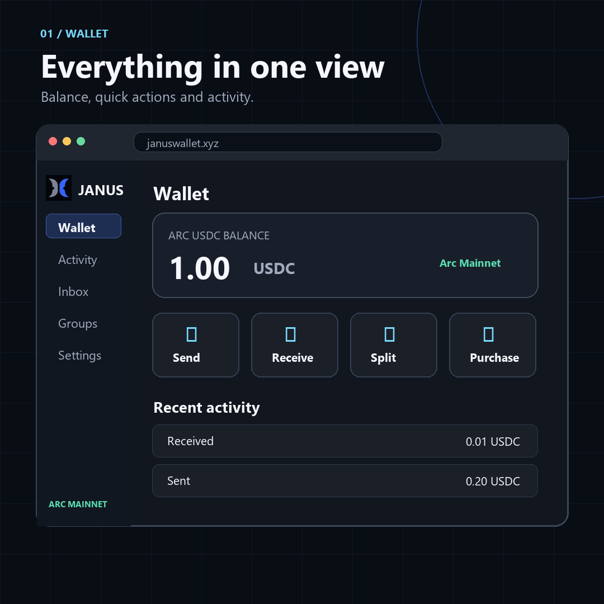
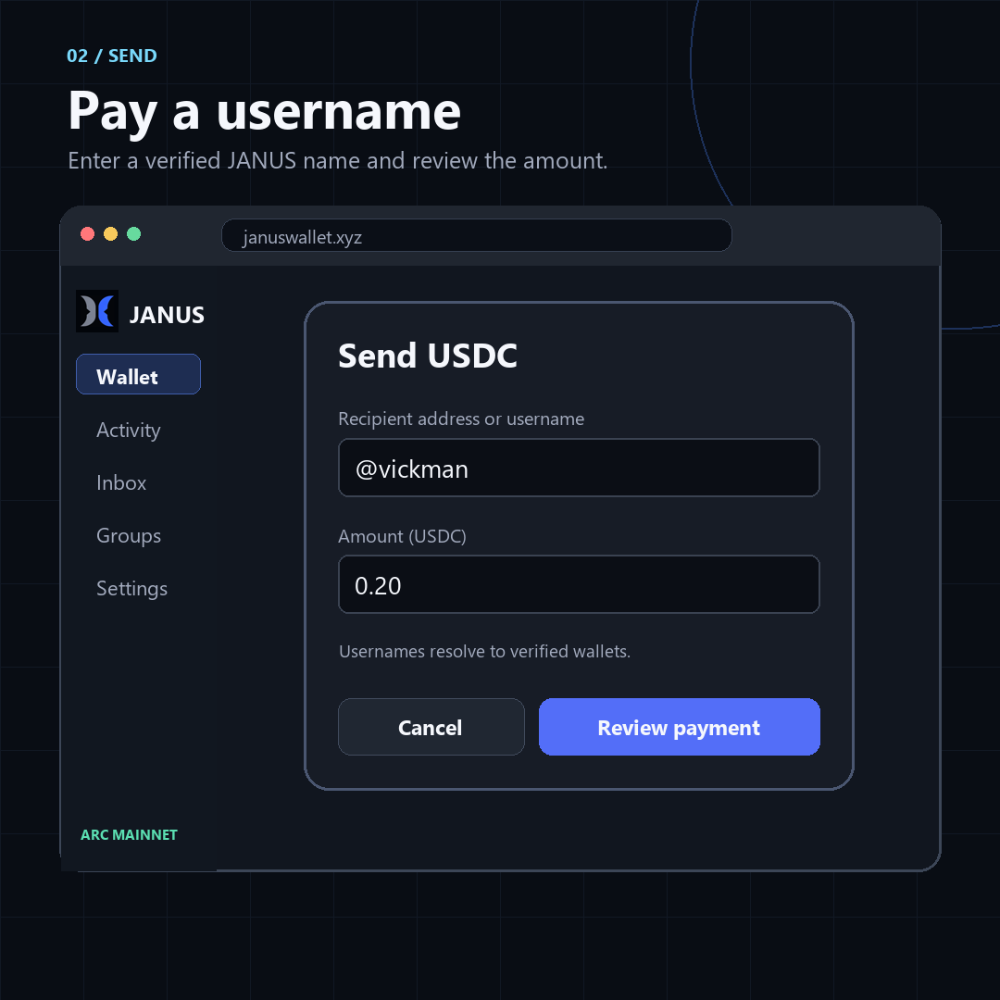
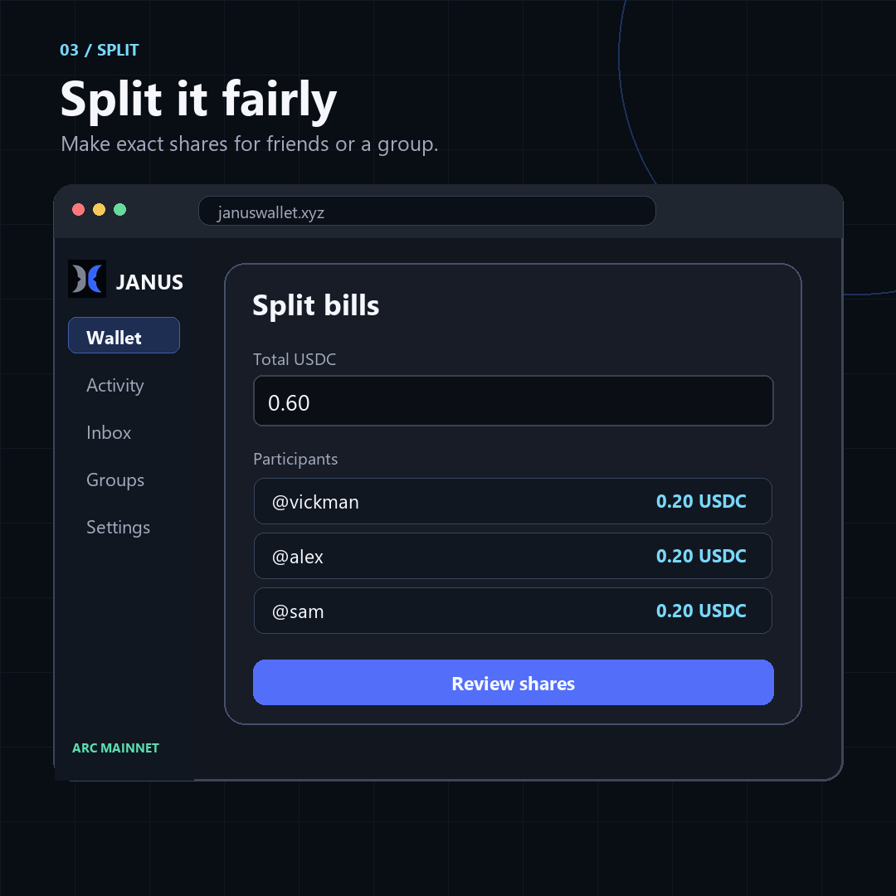
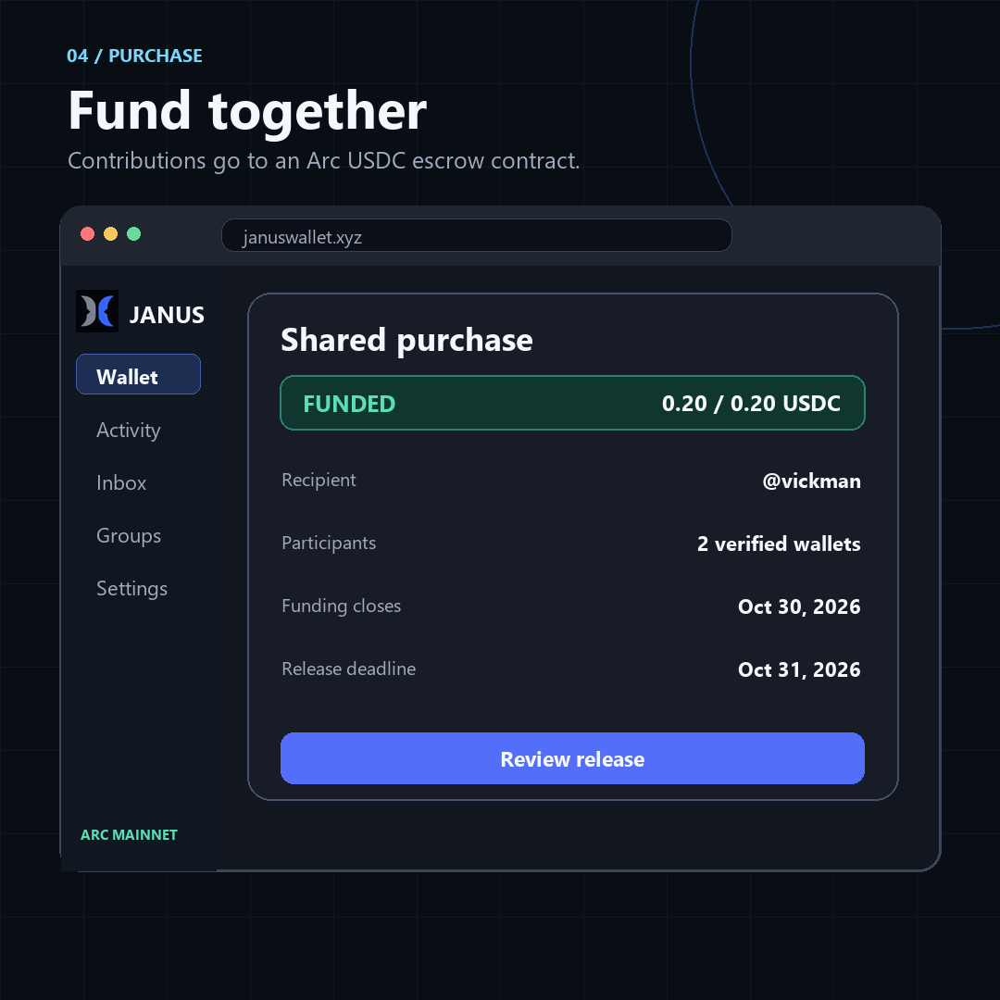
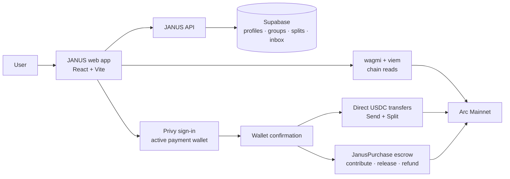

# JANUS Wallet

JANUS Wallet helps people send and receive USDC on Arc Mainnet, split bills, and fund shared purchases. It pairs a payment wallet with a verified JANUS username, so people can invite and pay one another without repeatedly sharing long wallet addresses. Shared purchases use an on-chain escrow contract; ordinary sends and split payments go directly to the chosen recipient.

**Try it:** [januswallet.xyz](https://januswallet.xyz) · [Watch the demo](https://youtu.be/dBig33jqzKc)

## At a glance

| | JANUS Wallet |
| --- | --- |
| Network | Arc Mainnet (chain ID `5042`) |
| Everyday payments | Direct USDC transfers to a wallet address or verified JANUS username |
| Split bills | Named or open exact shares, paid directly to the saved recipient |
| Shared purchases | Flexible contributions held by JanusPurchase until organizer release or contributor-claimed refund |
| Coordination | Verified usernames, groups, invitations, Inbox updates, and activity |
| Live app | [januswallet.xyz](https://januswallet.xyz) |

## Product tour

These are **illustrative frames from the [JANUS Wallet walkthrough](https://youtu.be/dBig33jqzKc)**. The names, balances, and amounts shown are examples; use the live app and Arc explorer for current state.

**Wallet.** See the Arc USDC balance, your payment actions, and recent activity in one place.



**Send.** Enter a verified JANUS username or wallet address, review the resolved recipient, then confirm the direct USDC transfer in your wallet.



**Split.** Set a bill total and recipient, assign exact shares to people or create open shares, and let each payer send directly to that recipient.



**Purchase.** Invite participants to fund a target in escrow. When it is fully funded, the organizer can release to the recipient before the deadline. Eligible cancellation or expiry lets contributors claim their own refunds.



## How the wallet works

1. Sign in with email, Google, or a wallet. Create a JANUS wallet through Privy or connect an existing Ethereum-compatible wallet. If more than one wallet is connected, choose the active payment wallet in Settings.
2. Set up your JANUS profile and verify the wallet linked to your username. A username resolves to its verified wallet when someone sends money or assigns a payment to you. Always review the resolved address before signing.
3. Use **Send** to transfer Arc Mainnet USDC directly to a verified username or wallet address. Use **Receive** to share your wallet address or its QR code. The QR contains the address only; the sender still needs to choose Arc Mainnet and USDC.
4. Check **Activity** for transfers and **Inbox** for assigned split shares, purchase invitations, group invitations, and purchase updates. The **Docs** card in the wallet explains each flow in the app.

The wallet displays your Arc USDC balance and asks you to confirm transactions in your active wallet. A confirmed direct transfer cannot be reversed by JANUS. Check the network, recipient, amount, and wallet prompt before approving.

## Split a bill or create a purchase?

| | Split | Shared Purchase |
| --- | --- | --- |
| Purpose | Collect exact shares for a bill | Collect flexible contributions toward a target |
| Where USDC goes | Each payer sends directly to the saved recipient | Contributions enter the JanusPurchase escrow contract |
| Participant amount | An assigned or claimed share | Any positive amount up to the remaining target; one wallet can fund it all |
| Recipient | Chosen when the split is created | Fixed on-chain at creation |
| If plans change | JANUS cannot refund direct payments | The organizer can cancel before release, or an eligible purchase can be marked expired; contributors then claim their own refunds |

For a **Split**, create named shares for verified JANUS accounts or open shares that people can claim through a link. You can include accepted group members in a named split. Each paid share transfers USDC straight to the saved recipient; there is no escrow.

For a **Shared Purchase**, choose the recipient, target amount, funding deadline, and later release deadline. Invite verified JANUS participants individually or from a group so they can find the purchase in Inbox. Invitations are for discovery, not an on-chain restriction: someone with the purchase ID can also contribute. Once fully funded, only the organizer can release the escrowed USDC to the recipient before the release deadline.

If the organizer cancels, or an underfunded or unreleased purchase becomes eligible for expiry, the relevant on-chain action must be confirmed first. **Refunds are not automatic:** each contributor claims their own contribution from escrow with their wallet. Passing a deadline alone does not send USDC back. Inbox updates help participants find purchases that need attention.

## Groups and usernames

Groups let an organizer invite verified JANUS accounts and reuse accepted members when creating a split or purchase. Members can accept or decline invitations; accepted members can leave, and the organizer can add or remove members. Editing a group does not change an existing payment or on-chain purchase. Username lookup and invitations depend on the JANUS API being available; the payment wallet and escrow transactions are on Arc.

## Architecture

JANUS separates social coordination from money movement. The API stores profiles, verified username-to-wallet links, groups, split assignments, invitations, and notifications. The active wallet signs payments; Arc Mainnet records direct USDC transfers and the shared-purchase escrow state.



A Split payment reaches the saved recipient directly. A Purchase contribution stays in the escrow contract until an eligible release or contributor refund; the JANUS API does not hold those funds.

## Mainnet contracts

- Arc Mainnet chain ID: `5042`
- Arc USDC: `0x3600000000000000000000000000000000000000` (6 decimals)
- [JanusPurchase escrow contract](https://explorer.arc.io/address/0x0523d830dd2c8767678f35b774ce2decf4faf2a5): `0x0523d830dd2c8767678f35b774ce2decf4faf2a5`

Contract deployment and Mainnet transaction evidence are documented in [`docs/CONTRACT-READINESS.md`](docs/CONTRACT-READINESS.md). The app also has a separate Arc Testnet purchase-testing route; the normal wallet, Send, Split, and Activity flows use Mainnet.

## Technology

React, Vite, TypeScript, and Tailwind CSS power the interface. Privy handles sign-in and wallet connections; wagmi and viem handle chain reads and wallet transactions. The JANUS API and Supabase store profiles, usernames, groups, invitations, and split records. `JanusPurchase` is a Solidity contract tested with Foundry. The web app is hosted on Vercel.

## Run locally

1. Install dependencies with `bun install`.
2. Copy `.env.example` to `.env.local` and fill in the required browser configuration. Put API-only credentials in an ignored `.env.server`; never expose its secrets through `VITE_` variables.
3. Start the API with `bun run dev:api` and the web app in another terminal with `bun run dev`.

Never commit local environment files or wallet private keys. The purchase contract address must be configured for the environment in which the app runs.

## Checks

```bash
bun run typecheck
bun run lint
bun run test
bun run build
bun run contracts:test
```
